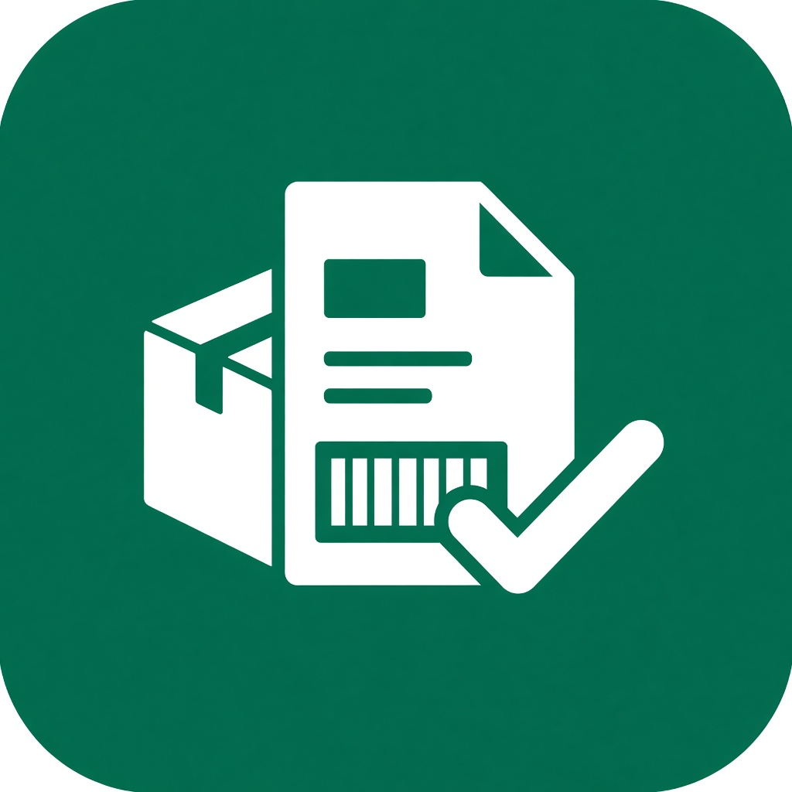

# Confere

Ferramenta da Ammac Indústria e Comércio de Alimentos Ltda para conferir o carregamento a partir das DANFE. O programa lê os PDFs neste computador, junta as notas pelo número do carregamento e monta o romaneio de separação.

Nada é enviado para a internet. A leitura fica na máquina.

## Autoria

Josias Azevedo da Silva e Regilson Azevedo da Silva.

## O que ele faz

Você solta os PDFs da DANFE baixados do sistema, um arquivo único ou várias notas de uma vez. O programa separa as notas pelo carregamento e mostra, para cada um:

- placa, emissão, quantidade de notas e de clientes
- volumes fechados, peso bruto e valor
- o romaneio por produto, com os volumes fechados de cada lote
- a quebra de lote, quando o volume junta sobras de lotes diferentes
- o fracionado, quando sobra quantidade de um lote só

Os parâmetros de embalagem, fardos por volume e unidades por fardo, podem ser ajustados. O código do produto tem prioridade. Sem código, o nome da nota precisa conter as palavras cadastradas. Essas alterações ficam salvas neste computador.

O resultado pode ser copiado para o Excel, baixado em planilha ou impresso, com a visualização das páginas antes de enviar para a impressora.

## Para quem é

O uso é exclusivo da Ammac Indústria e Comércio de Alimentos Ltda.